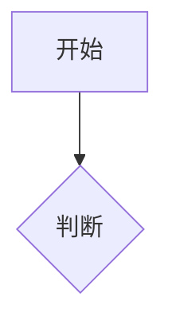

# Obsidian 笔记

只讲 Obsidian 的扩展语法。标题、加粗、列表、代码块、表格按标准 Markdown 写，不再重复。

## 编辑已有笔记：保真第一

改别人写好的笔记时，格式是硬约束，不是风格问题：

- frontmatter 里没要求改的键，一个字符都不动——顺序、引号风格、缩进全保留
- `[[...]]`、`![[...]]`、`^block-id`、`%%注释%%` 原样留着，不"顺手规范化"
- 只改要求改的那几行。不重排段落、不归一空行、不补全别人没写完的列表
- 动手前先 read 全文，改完再 read 一遍核对

## 内部链接

```markdown
[[笔记名]]                  链接
[[笔记名|显示文字]]          自定义显示
[[笔记名#标题]]              链到标题
[[笔记名#^block-id]]          链到块
[[#本笔记内的标题]]           本笔记内跳转
```

- 链接按**文件名**解析，不认 frontmatter 里的 `aliases`。想显示别名得写 `[[笔记名|别名]]`
- 表格里的别名竖线要转义：`[[笔记\|别名]]`
- 段落后面紧跟表格时，必须空一行，否则表格会渲染成纯文本

块 ID 接在段落尾部：

```markdown
这段可以被链接。^my-block-id
```

列表和引用块要把块 ID 单独放一行：

```markdown
> 一段引用

^quote-id
```

## 嵌入

在 wikilink 前加 `!`：

```markdown
![[笔记名]]            嵌入整篇
![[笔记名#标题]]        嵌入一节
![[image.png]]         嵌入图片
![[image.png|300]]     指定宽度
![[document.pdf#page=3]]  PDF 指定页
```

## Callout

```markdown
> [!note]
> 基本款。

> [!warning] 自定义标题
> 带标题。

> [!faq]- 默认折叠
> `-` 折叠，`+` 展开。
```

常用类型：`note` `tip` `warning` `info` `example` `quote` `bug` `danger` `success` `failure` `question` `abstract` `todo`。

## Properties（frontmatter）

```yaml
---
title: 笔记标题
date: 2024-01-15
tags:
  - project
  - active
aliases:
  - 另一个名字
cssclasses:
  - custom-class
---
```

默认三件套：`tags`（可搜索的标签）、`aliases`（补全提示里的别名，链接仍用文件名）、`cssclasses`（样式类）。

## 标签

```markdown
#tag          行内标签
#nested/tag   带层级的标签
```

可含字母、数字、下划线、连字符、斜杠；**至少要有一个非数字字符**（`#1984` 无效，`#1984book` 有效）。空格就是标签结尾，`#my tag` 是 `#my`。

## 注释

```markdown
可见 %%这截看不见%% 文本。

%%
整块隐藏。
%%
```

## 高亮

```markdown
==高亮==
==🔴彩色高亮==
```

彩色高亮在 `==` 后紧跟 🔴🟠🟡🟢🔵🟣 之一（或同色方块），别的 emoji 当普通文字。

## 数学与图表

```markdown
行内：$e^{i\pi}+1=0$

块：
$$
\frac{a}{b} = c
$$
```

````markdown

````

Mermaid 节点链到笔记：加一行 `class NodeName internal-link;`。

## 脚注

```markdown
正文带脚注[^1]。

[^1]: 脚注内容。

行内脚注。^[直接写在括号里]
```

## 交付前

在 Obsidian 阅读视图里看一眼再交。渲染不对的常见原因：表格前少空行、wikilink 别名没转义、callout 类型拼错、frontmatter 里 YAML 缩进坏了。
